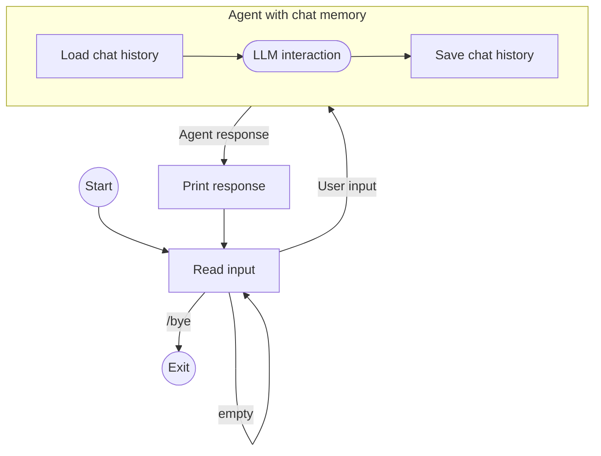

> Retained Kotlin guide from JetBrains/Koog, version family 1.3.0 / 1.3.0-beta. See [source caveats](../../../version-and-migration.md) before adapting snippets.

# Build a chat agent with memory

This guide demonstrates how to create a conversational command-line chat application
that remembers previous messages across multiple agent interactions using the [ChatMemory](index.md) feature.

The CLI application executes the following loop:

- Reads the input from the console
- If the input is not `/bye` or empty, it runs the agent with the user input and the specified session ID
- The agent first loads the previous conversation history for the session ID
  and adds the messages to the prompt in addition to the user input
- The agent performs the LLM interaction
- At the end of the run, before returning the response,
  the agent stores the full conversation history under the specified session ID,
  limiting the size to 20 latest messages
- The app then prints out the response from the agent

Here is an illustration:



## Code

??? note "Prerequisites"

    [prerequisites](../../snippets/quickstart-snippets.md#prerequisites)

    Add the main [Koog agents package](https://central.sonatype.com/artifact/ai.koog/koog-agents/)
    and the [chat memory feature package](https://mvnrepository.com/artifact/ai.koog/agents-features-memory)
    as dependencies:

    === "Gradle (Kotlin)"
    
        ```kotlin title="build.gradle.kts"
        dependencies {
            implementation("ai.koog:koog-agents:1.3.0")
            implementation("ai.koog:agents-features-memory:1.3.0")
        }
        ```
    
    [api-key](../../snippets/quickstart-snippets.md#api-key)

    Examples on this page assume that you have set the `OPENAI_API_KEY` environment variable.

=== "Kotlin"

    
    ```kotlin
    suspend fun main() {
        val sessionId = "my-conversation"

        simpleOpenAIExecutor(System.getenv("OPENAI_API_KEY")).use { executor ->
            val agent = AIAgent(
                promptExecutor = executor,
                llmModel = OpenAIModels.Chat.GPT5_2,
                systemPrompt = "You are a helpful assistant."
            ) {
                install(ChatMemory) {
                    windowSize(20) // keep only the last 20 messages
                }
            }

            while (true) {
                print("You: ")
                val input = readln().trim()
                if (input == "/bye") break
                if (input.isEmpty()) continue

                val reply = agent.run(input, sessionId)
                println("Assistant: $reply\n")
            }
        }
    }
    ```

## Implementation details

The second argument to `agent.run()` is the [session ID](index.md#session-ids)
used to identify and differentiate between ongoing conversations.
In our example, it is constant because there is only one conversation at a time.
In a real application, you can have a separate unique ID for conversations related to the same user, for example.

The agent uses the default [history provider](index.md#history-providers)
that stores the conversation history in memory.
This means that the history is lost when the application exits.
In a real application, you should implement a custom history provider
to persistently store the history in a database or a file.

The `windowSize(20)` [preprocessor](index.md#preprocessors) ensures a limited context size:
the agent stores only up to 20 most recent messages.
Without this, the prompt size can grow beyond the context limit.

## Example session

```
You: My name is Alice.
Assistant: Nice to meet you, Alice! How can I help you today?

You: What's my favorite color? It's blue.
Assistant: Got it — your favorite color is blue!

You: What's my name?
Assistant: Your name is Alice!
```

Even though each interaction is a separate agent run, the agent correctly answers "Your name is Alice!"
because the `ChatMemory` feature loaded earlier exchanges before processing the third message.
