<div align="center">


# Scottie

*On-device and hybrid AI conversational banking assistant for Android, built with JetBrains Koog, AndroidX A2UI, and Slack Circuit*


[Overview](#overview) • [Features](#features) • [Product Guide](#product-guide) • [Architecture](#architecture) • [Agent, Tools & A2UI Workflows](#agent-tools--a2ui-workflows) • [Model Catalog & Providers](#model-catalog--providers) • [Getting Started](#getting-started) • [Testing & Verification](#testing--verification)

</div>

Scottie is an Android application that demonstrates safe, deterministic **Agent-to-UI (A2UI)** conversational banking for **Interac e-Transfer** and **financial transaction insights**. Instead of relying on an LLM to generate free-form financial advice or directly execute money movement, Scottie confines the LLM to **intent classification and entity extraction** using read-only tools, while deterministic domain logic and reactive **AndroidX A2UI** surfaces handle validation, user edits, and transaction execution.

> [!TIP]
> You can run Scottie **100% offline on-device** by downloading quantized `.litertlm` text models (Gemma 4, Qwen 3/3.5, DeepSeek R1, MiniCPM5) and Sherpa-ONNX speech-to-text models (NVIDIA Parakeet, Canary, Whisper), or connect to any **OpenRouter / OpenAI-compatible** endpoint for cloud inference.

## Overview

Building conversational financial assistants requires a strict trust boundary between probabilistic model output and high-stakes transactional execution. Scottie solves this by separating **understanding** from **acting**:

1. **Probabilistic Intent Extraction (`InteracAssistantAgent`)**: A JetBrains Koog `AIAgent` equipped with read-only `@Tool` functions (`getAccountBalances`, `findContacts`, `getTransactions`) classifies the user's prompt into a single structured `AssistantIntent` JSON payload.
2. **Deterministic Domain Resolution (`InteracResolution`, `ContactMatcher`, `TransactionInsights`)**: Pure Kotlin domain services resolve account hints, rank contacts using Damerau-Levenshtein fuzzy matching, check account eligibility, and evaluate transaction verification rules (salary, rent, subscriptions, duplicate/large charge anomalies).
3. **Interactive A2UI Surfaces (`InteracSurfaceTemplates` & `ProcessorA2uiBridge`)**: `InteracAssistantPresenter` emits standard A2UI `v0.9` JSON envelopes (`createSurface`, `updateDataModel`, `updateComponents`, `deleteSurface`) into an `A2uiMessageProcessor`, which drives native Jetpack Compose components (`BalanceCard`, `InteracForm`, `TransactionList`, `Confirmation`, `Alert`, `Badge`) with two-way data bindings and typed client events.

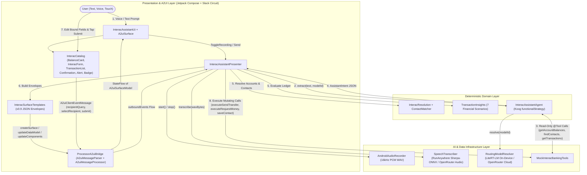

> [!IMPORTANT]
> **Hard Trust Boundary**: Only `getAccountBalances()`, `findContacts()`, and `getTransactions()` are exposed to the Koog `ToolRegistry`. Mutating operations (`executeSendTransfer()`, `executeRequestMoney()`, `saveContact()`) are never registered as LLM tools and can only be invoked by `InteracAssistantPresenter` after the user explicitly submits a validated `InteracForm`.

## Features

- **Conversational Interac e-Transfer**: Send money or request funds using natural language prompts (e.g., *"Send $50 to Alice from chequing"* or *"Request $30 from Jane for dinner"*), pre-populating an interactive A2UI transfer slip.
- **Deterministic Financial Insights**: Ask natural-language questions across 7 transaction analysis workflows—salary deposit verification, rent payment tracking, recurring subscriptions & utilities, duplicate/large charge anomaly detection, refunds & transfers, merchant/category breakdowns, and date-range ledgers.
- **Native AndroidX A2UI Rendering**: Renders structured `v0.9` A2UI surfaces in Jetpack Compose with reactive path bindings (`bind` / `bindUpdater`), debounced contact autocomplete, dynamic Autodeposit / Security Q&A toggling, and in-place surface transitions from draft form to confirmation receipt.
- **Hybrid On-Device & Cloud Inference**: Switch seamlessly between local `.litertlm` models executed via Google AI Edge LiteRT-LM and remote models hosted on OpenRouter or any OpenAI-compatible gateway.
- **Voice-to-Prompt Transcription**: Built-in 16 kHz mono WAV audio recorder paired with on-device Sherpa-ONNX speech recognition (via RunAnywhere SDK) or multimodal cloud audio transcription.
- **Resumable Foreground Model Manager**: Download multi-gigabyte model weights with HTTP `Range` resume support, pre-flight RAM/storage compatibility checks, and an Android `dataSync` foreground notification service.

---

## Product Guide

*This section is written for product managers, designers, and stakeholders looking for a plain-English overview of how Scottie works from a customer and business perspective.*

### Why Chat + Interactive Cards Instead of Menus or Text Walls?

- **Traditional banking apps** force customers to tap through 5–7 screens of menus just to send an e-Transfer or filter their transactions.
- **Traditional AI chatbots** reply with long paragraphs of text and carry the risk of "hallucinating" numbers or performing unintended actions.
- **Scottie combines the best of both**: A customer types or speaks a single sentence—like *"Send $50 to Alice from chequing"*—and Scottie responds with an **interactive banking card** (a mini-app right inside the conversation) that is already filled out and ready for review.

### How Scottie Keeps Money Safe (The 3-Step Safety Model)

A common product and compliance question is: **"Can the AI make a math mistake or accidentally send money to the wrong person?"**

In Scottie, the answer is **no**, because the AI and the banking system have strictly separated jobs:

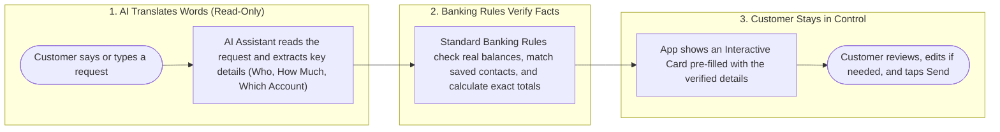

1. **The AI only listens and drafts**: The AI is never connected to the "Send Money" button. Its only job is to understand whether the customer wants to **Check Balances**, **Send Money**, **Request Money**, or **Review Transactions**, and pull out the words the customer used.
2. **Standard banking rules do all the math and checks**: Every dollar total, balance check, contact match, and duplicate-charge alert is calculated by exact banking logic—never guessed by the AI.
3. **A human always approves money movement**: To send or request money, the customer always sees a clear interactive form card first, can adjust any detail with one tap, and must press the final **Send transfer** or **Send request** button themselves.

---

### Customer Journey 1: Checking Account Balances

Customers can ask about all of their accounts at once or ask about a specific account in their own words. Even if they ask for an account they don't have (like *"my crypto account"*), Scottie avoids a dead end by giving a friendly heads-up and showing their actual accounts.

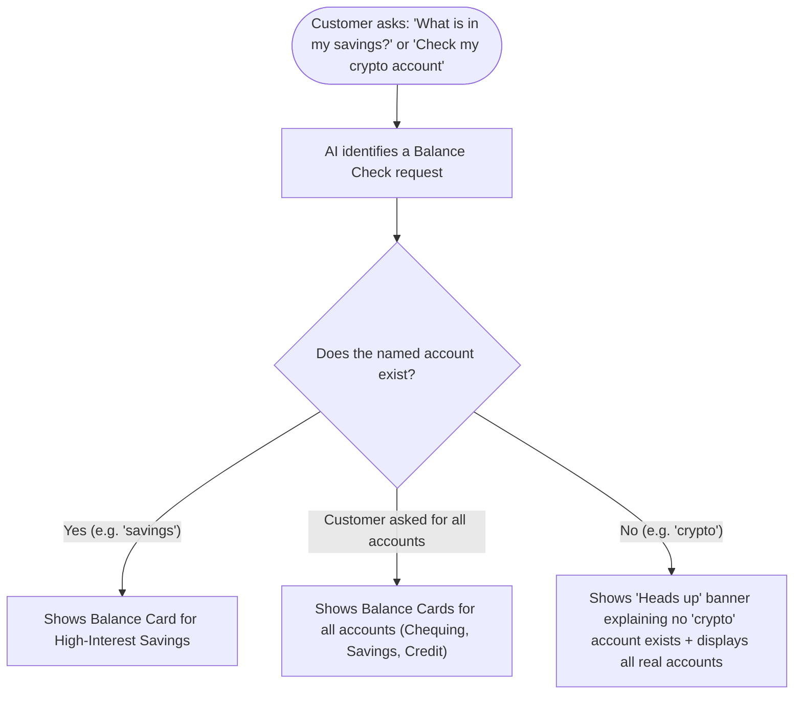

---

### Customer Journey 2: Sending or Requesting an Interac e-Transfer

When a customer asks to send or request money, Scottie prepares the transfer for them and adapts the card in real time as they tap or type:

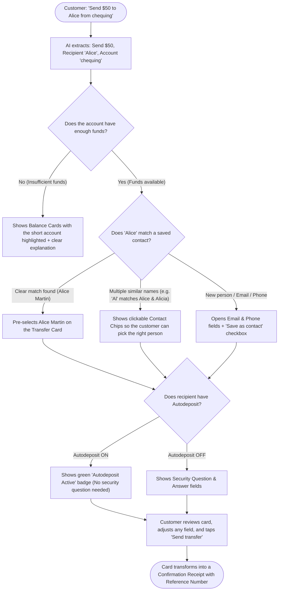

**Key Product Highlights for Transfers & Requests:**
- **Smart Typo Tolerance**: If a customer types *"Send $20 to Rob"*, Scottie's contact matcher recognizes *"Rob"* is a close match for **Bob Vance** or **Robert Singh** and surfaces them as one-tap chips.
- **No Unnecessary Fields**: If the selected contact has **Autodeposit** enabled, the Security Question and Answer fields automatically disappear and are replaced with a green **Autodeposit Active** badge. If the customer switches to a contact without Autodeposit, the security fields appear automatically.
- **Channel Protection**: If a contact only has an email address on file, the delivery channel automatically locks to **Email** so the customer cannot accidentally send an SMS to a missing phone number.
- **In-Place Receipt**: Once the transfer or request succeeds, the form card smoothly turns into a **Confirmation Receipt** showing the reference ID, timestamp, account, and status (`Sent`, `Pending security answer`, or `Request sent`).

---

### Customer Journey 3: Answering Everyday Spending & Income Questions

Customers don't just ask *"show my transactions"*—they ask specific questions to verify their finances. Scottie supports **7 built-in financial insight experiences** that give a direct answer at the top of the card along with the supporting transactions:

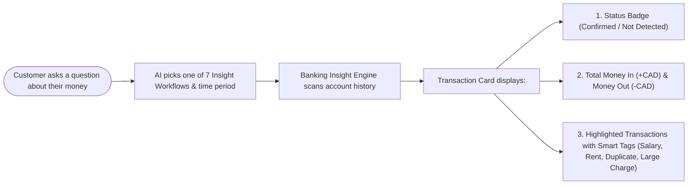

| What the Customer Asks | What Scottie Checks | What the Customer Sees on the Card |
| :--- | :--- | :--- |
| **"Did I get paid this month?"** | Checks for payroll deposits or regular recurring income ($\ge \$500$). | **Confirmed** or **Not Detected** badge, confirmation banner, `Salary` tags, and recent past paycheques for reference if this month's hasn't arrived yet. |
| **"Did I pay my rent?"** | Checks for housing/landlord payments or regular monthly rent debits. | **Confirmed** or **Not Detected** badge, rent status banner, `Rent` tags, and past rent payments for comparison. |
| **"What subscriptions and bills am I paying?"** | Finds utility bills, streaming services, and any charge that repeats monthly at a similar amount. | A clean list of recurring charges tagged `Recurring` with the total outflow calculated. |
| **"Do I have any duplicate or unusual charges?"** | Looks for identical charges at the same merchant within 48 hours, or single purchases much larger than normal. | Flags potential double-billings with a `Duplicate` warning badge and big purchases with a `Large Charge` badge. |
| **"Did my refund from TechMart arrive?"** | Filters specifically for merchant refunds and e-Transfers. | Shows matching credits and transfers tagged `Refund` or `Transfer`. |
| **"How much did I spend on coffee / groceries?"** | Searches merchants and categories (understanding that *"coffee"* or *"restaurants"* means **Dining**, and *"hydro"* means **Utilities**). | Total spent in that category plus every matching transaction. |
| **"Show my transactions from last month"** | Filters by exact dates or natural phrases (*today*, *this week*, *last 7 days*, *last month*). | Chronological statement with total money in and money out for that period. |

---

### Customer Journey 4: On-Device Privacy vs. Cloud Flexibility

Scottie lets the customer (or product team) choose between running AI **entirely on the phone** or **in the cloud**, for both text and voice:

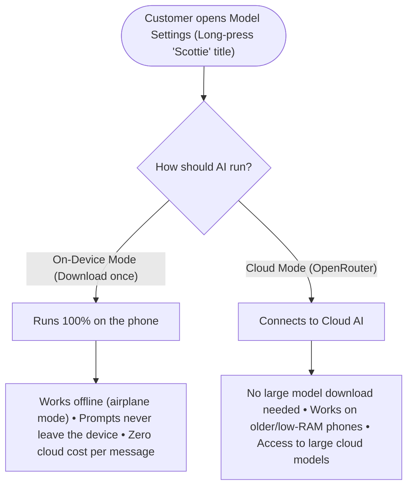

---

## Architecture

Scottie follows **Clean Architecture** organized into vertical feature slices (`feature/interacbanking` and `feature/modeldownload`), shared core libraries (`core/ui` and `core/ai`), and Hilt dependency injection modules (`di/`).

```text
app/src/main/java/com/jayvijay/scottie
├── MainActivity.kt                        # Single-Activity host with Circuit NavigableCircuitContent
├── ScottieApplication.kt                  # @HiltAndroidApp entry point
├── core/
│   ├── ai/                                # Shared LiteRT, OpenRouter, and RunAnywhere STT adapters
│   └── ui/                                # ScottieTheme, design tokens, and shared Xela/Scottie UI components
├── di/                                    # Hilt modules (AiModule, DataModule, InteracModule, PresentationModule)
└── feature/
    ├── interacbanking/
    │   ├── domain/
    │   │   ├── entities/                  # Account, InteracContact, Recipient, Transaction, TransferResult
    │   │   ├── repository/                # TextModelSource, AudioRecorder interfaces
    │   │   ├── agent/
    │   │   │   ├── tools/                 # InteracBankingTools service contract
    │   │   │   └── workflow/              # InteracAssistantAgent, AssistantIntent, IntentExtractor, SpeechTranscriber
    │   │   └── usecase/                   # InteracResolution, ContactMatcher, TransactionInsights
    │   ├── data/
    │   │   └── ai/                        # MockInteracBankingTools (@Tool set + ledger), AndroidAudioRecorder
    │   └── presentation/
    │       ├── InteracAssistantPresenter  # Circuit Presenter orchestrating turns, resolution, and A2UI events
    │       ├── InteracAssistantUi         # Circuit UI rendering chat stream, voice controls, and A2uiSurface
    │       └── a2ui/                      # ProcessorA2uiBridge, InteracCatalog, InteracSurfaceTemplates, custom A2uiComponents
    └── modeldownload/
        ├── domain/                        # ModelCatalog, OpenRouterConfig, ModelCompatibility, repository contracts
        ├── data/                          # LiteRtModelRuntime, RunAnywhereModelRuntime, OpenRouterModelsClient, ModelDownloadService
        └── presentation/                  # ModelDownloadPresenter, ModelDownloadUi, model cards & OpenRouter settings
```

| Layer | Responsibility | Key Types |
| :--- | :--- | :--- |
| **Presentation (`presentation/`)** | Slack Circuit screens, state/event contracts, presenters, Compose UI, and A2UI catalog/surface management | `InteracAssistantPresenter`, `InteracAssistantUi`, `ProcessorA2uiBridge`, `InteracSurfaceTemplates`, `ModelDownloadPresenter` |
| **Domain (`domain/`)** | Pure Kotlin business entities, Koog agent workflow, deterministic resolution rules, and repository interfaces | `InteracAssistantAgent`, `AssistantIntent`, `InteracResolution`, `ContactMatcher`, `TransactionInsights`, `ModelCompatibility` |
| **Data (`data/` & `core/ai/`)** | Tool implementations, audio capture, model download runtimes, foreground service, and LLM/STT client adapters | `MockInteracBankingTools`, `AndroidAudioRecorder`, `LiteRtModelRuntime`, `RunAnywhereModelRuntime`, `OpenRouterTextModels` |
| **DI (`di/`)** | Application-level Dagger Hilt bindings, Circuit multibindings, and model routing | `AiModule`, `DataModule`, `InteracModule`, `PresentationModule` |

---

## Agent, Tools & A2UI Workflows

Every user interaction in Scottie follows a well-defined pipeline across the **User**, **Presenter**, **Koog Agent**, **LLM**, **Tools**, and **A2UI Processor**. Below are the detailed sequence and flow diagrams for each case.

### 1. Voice Input & Speech-to-Text Pre-Stage

When an audio model is active (either an on-device Sherpa-ONNX model or an audio-capable OpenRouter model), a microphone button appears in the composer. Recording captures raw 16 kHz mono 16-bit PCM audio, wraps it in a RIFF WAV header, and transcribes it directly into the composer input field so the user can review or edit the text before sending.

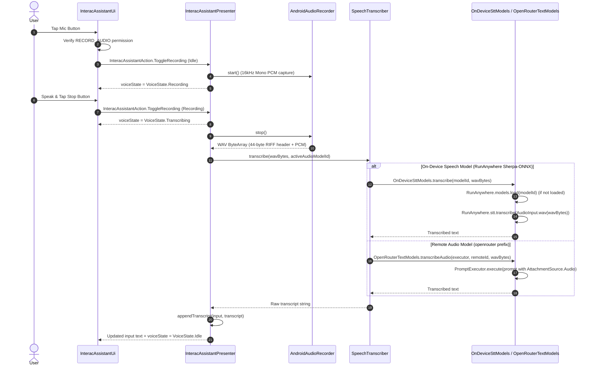

---

### 2. Koog Agent & LLM Intent Extraction Loop

When the user taps **Send**, `InteracAssistantAgent` runs a single-turn Koog `AIAgent` (`temperature = 0.0`, `maxIterations = 6`) with a `functionalStrategy`. The LLM can invoke read-only tools up to 3 rounds (`MAX_TOOL_ROUNDS = 3`) before returning an `AssistantIntent` JSON object. If the model returns conversational prose instead of valid JSON, the strategy triggers `requestLLMStructured<AssistantIntent>` with a `StructureFixingParser` (`retries = 1`) before falling back to `AssistantIntent.FALLBACK` (`Intent.OTHER`).

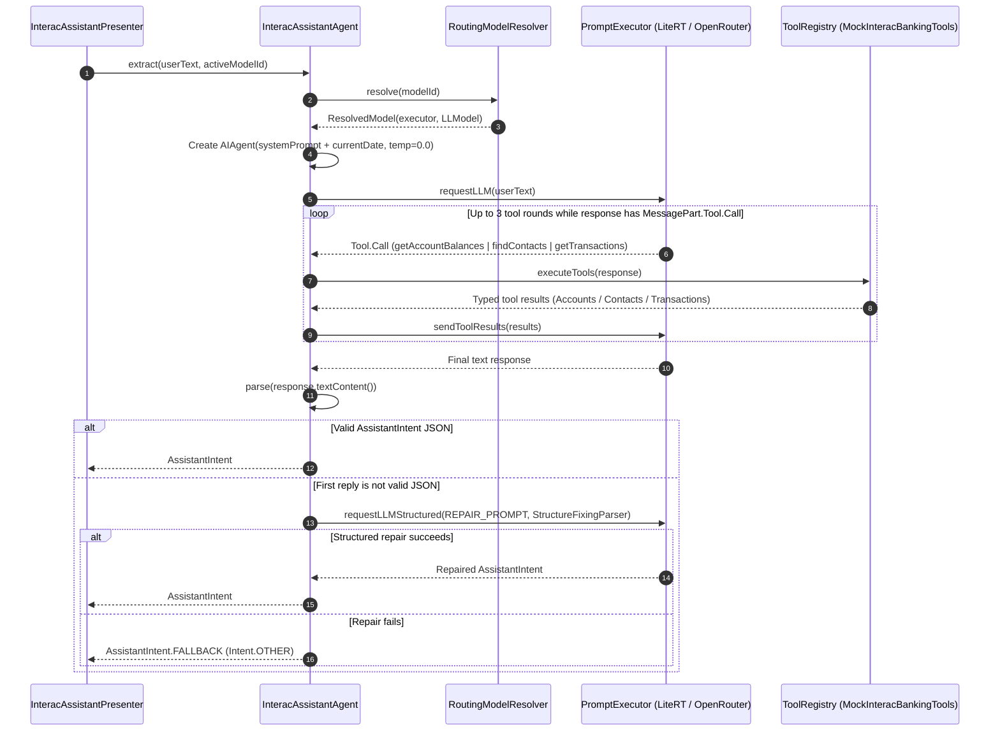

---

### 3. Case A: Account Balance Inquiry (`Intent.BALANCE`)

For balance requests (e.g., *"What's my balance?"*, *"How much is in my savings?"*, or *"Check my crypto account"*), the agent extracts `intent = BALANCE` and an optional raw `accountHint`. The presenter resolves matching accounts via `InteracResolution.matchAccounts` and emits A2UI envelopes to render `BalanceCard` components (plus an informational `Alert` if the hinted account name was not found).

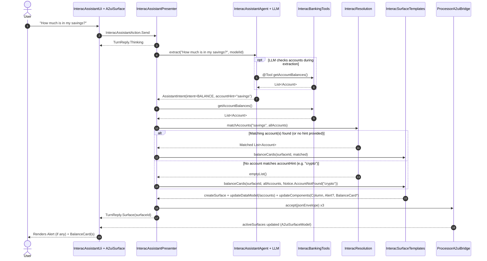

---

### 4. Case B: Send Interac e-Transfer (`Intent.SEND`) & Interactive Form Lifecycle

Sending money is a two-phase workflow:
1. **Phase 1 (Pre-Flight & Surface Seeding)**: The agent extracts `amount`, `recipientQuery`, `accountHint`, and `channelHint`. The presenter checks account balances and contact rankings. If the requested amount cannot be covered, it immediately renders `BalanceCard`s with an error `Alert` instead of a form. Otherwise, it seeds an interactive `InteracForm` surface.
2. **Phase 2 (Interactive A2UI Form & Execution)**: The user interacts with the rendered `InteracForm`. Two-way data bindings (`bindUpdater`) update `/form/*` paths in real time, client events (`recipientQuery`, `selectRecipient`, `submit`) flow back through `ProcessorA2uiBridge.events`, and `executeSendTransfer` is called only when the user taps **Send transfer**.

#### Phase 1: Intent Extraction, Balance Guards & Form Seeding

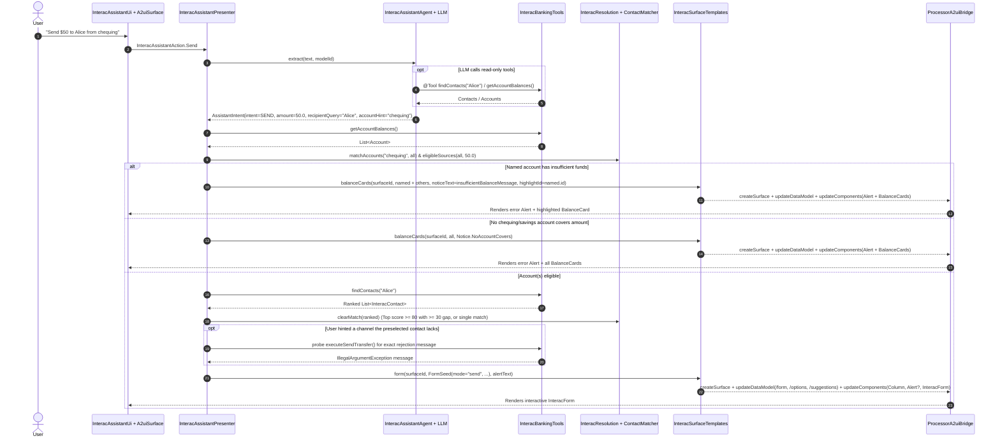

#### Phase 2: User Actions on `InteracForm` (Search, Select, Validate & Submit)

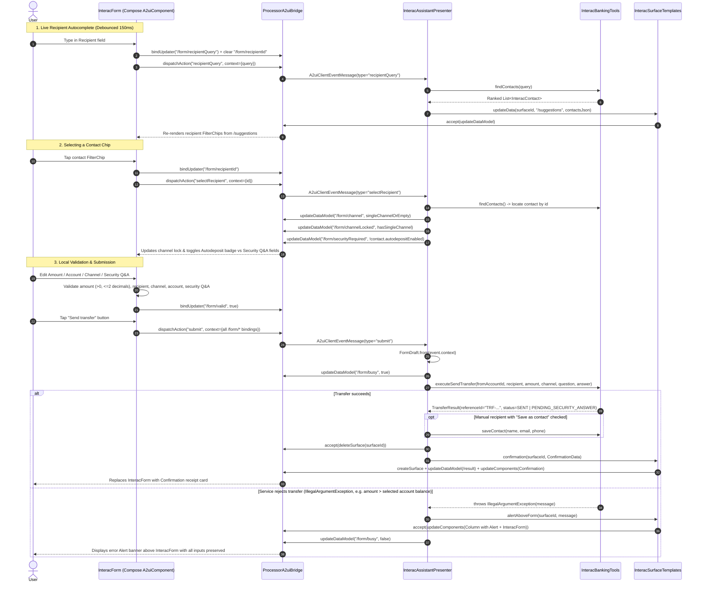

---

### 5. Case C: Request Money via Interac (`Intent.REQUEST`)

Requesting money (e.g., *"Request $30 from Jane for dinner"*) follows the interactive A2UI form lifecycle in `MODE_REQUEST`:
- Credit cards are excluded from deposit accounts via `InteracResolution.eligibleDeposits`.
- `InteracForm` displays an emerald accent bar, a **Deposit account** selector, and an optional **Memo** field instead of Security Question/Answer fields (`securityRequired = false`).
- Submitting dispatches `EVENT_SUBMIT`, which invokes `InteracBankingTools.executeRequestMoney()` and replaces the form surface with a `Confirmation` receipt showing status `REQUEST_SENT` and reference `REQ-...`.

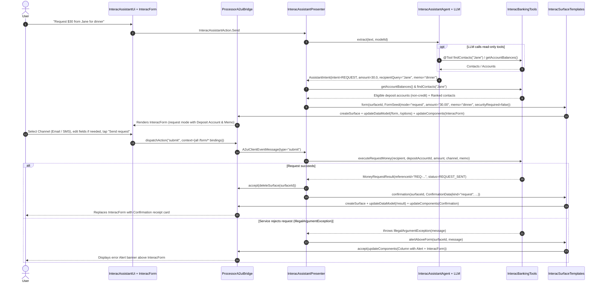

---

### 6. Case D: Transaction Queries & Financial Insights (`Intent.TRANSACTIONS`)

When the user asks about their transaction history, bills, income, or anomalies, the agent extracts `intent = TRANSACTIONS` along with a `TransactionScenario`, date bounds (`startDate` / `endDate` as ISO dates or relative tokens like `this_month`, `last_month`, `last_7_days`), `searchQuery`, `accountHint`, and optional `amount` threshold. `TransactionInsights.evaluate()` deterministically analyzes the ledger and `InteracSurfaceTemplates.transactionResults()` renders the `TransactionList` A2UI component.

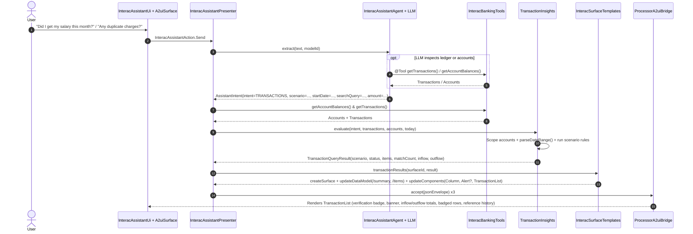

#### Supported `TransactionScenario` Workflows

| Scenario | Example Prompts | Deterministic Evaluation Rules (`TransactionInsights`) | A2UI `TransactionList` Output |
| :--- | :--- | :--- | :--- |
| **`SALARY_CHECK`** | *"Did I get my salary?"*, *"Did my paycheque arrive?"* | Matches `INCOME` credits, payroll keywords, or recurring inflows ($\ge \$500$ within 15% median tolerance) in target period (defaults to current month). | `Confirmed` / `Not Detected` badge, verification banner, `SALARY` badges, and up to 4 prior reference deposits if missing. |
| **`RENT_CHECK`** | *"Did I pay my rent?"*, *"Check my lease payment"* | Matches `HOUSING` debits, rent/landlord keywords, or recurring monthly debits ($\ge \$500$ within 10% median tolerance) in target period. | `Confirmed` / `Not Detected` badge, rent verification banner, `RENT` badges, plus prior reference payments. |
| **`SUBSCRIPTIONS_BILLS`** | *"Show recurring subscriptions"*, *"Monthly utility bills"* | Matches `SUBSCRIPTIONS` and `UTILITIES` categories plus recurring monthly non-housing debits (within 15% median tolerance across $\ge 2$ months). | List of recurring charges tagged with `RECURRING` badge and total outflow summary. |
| **`ANOMALIES`** | *"Any duplicate charges?"*, *"Unusual charges over $200"* | Flags same-account, same-merchant, identical-amount debits within 48 hours (`DUPLICATE`) and non-housing debits $\ge \max(\$250, 3\times \text{median debit})$ or user threshold (`LARGE_CHARGE`). | `Confirmed` (warning) / `Not Detected` (success) badge, anomaly banner, and `DUPLICATE` / `LARGE_CHARGE` warning badges. |
| **`REFUNDS_TRANSFERS`** | *"Did my refund arrive?"*, *"Recent transfers to Alice"* | Filters `REFUND` and/or `TRANSFER` transactions with optional party/merchant filter. | Inflow/outflow pills and rows badged `REFUND` or `TRANSFER`. |
| **`MERCHANT_CATEGORY`** | *"How much did I spend on groceries?"*, *"Uber rides"* | Multi-token search across merchant, descriptor, category, and account name with synonym stemming (`coffee` $\rightarrow$ `dining`, `hydro` $\rightarrow$ `utilities`, `ride` $\rightarrow$ `transport`). | Filtered spending breakdown with inflow/outflow totals. |
| **`DATE_RANGE`** | *"Transactions last 7 days"*, *"Transactions last month"* | Filters ledger across explicit ISO dates (`YYYY-MM-DD`) or relative tokens (`today`, `this_week`, `this_month`, `last_month`, `last_7_days`, `last_30_days`). | Reverse-chronological transaction list with period summary. |

---

### 7. Case E: Off-Topic Guardrails (`Intent.OTHER`) & Failure Recovery

Requests outside balances, transfers, money requests, or transactions—as well as inference or A2UI rendering failures—are handled without leaving dangling surfaces:

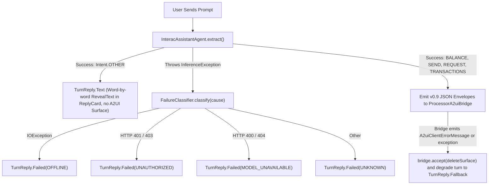

---

## Model Catalog & Providers

Open **Model settings** by tapping **Download a Model to Get Started** on first launch, or by **long-pressing the "Scottie" header logo** in the top toolbar at any time.

### On-Device Text Models (Google AI Edge LiteRT-LM)

Downloaded `.litertlm` weights are stored under `<filesDir>/models/litert/` and executed locally through Koog's `LiteRTLLMClient`.

| Model | File ID | Download Size | Est. RAM Needed | Notes |
| :--- | :--- | :--- | :--- | :--- |
| **Gemma 4 E2B** | `gemma-4-E2B-it.litertlm` | ~2.59 GB | ~3.36 GB | Default LiteRT model config |
| **Gemma 4 E4B** | `gemma-4-E4B-it.litertlm` | ~3.66 GB | ~4.76 GB | Mid-sized general-purpose model |
| **Gemma 4 12B** | `gemma-4-12B-it.litertlm` | ~6.88 GB | ~8.95 GB | High-capacity model for flagship devices |
| **Qwen3 0.6B** | `Qwen3-0.6B.litertlm` | ~614 MB | ~798 MB | Ultra-compact model for low-memory devices |
| **Qwen3.5 2B** | `Qwen3.5-2B_int8.litertlm` | ~2.12 GB | ~2.75 GB | INT8 quantized Qwen 3.5 |
| **DeepSeek R1 Distill Qwen 1.5B** | `DeepSeek-R1-Distill-Qwen-1.5B_multi-prefill-seq_q8_ekv4096.litertlm` | ~1.83 GB | ~2.38 GB | Q8 quantized reasoning distillation |
| **MiniCPM5 2B** | `MiniCPM5-2B_int4.litertlm` | ~1.55 GB | ~2.02 GB | INT4 quantized compact model |
| **Gemma 3 1B / 270M & FunctionGemma 270M** | `gemma3-*.litertlm`, `mobile_actions_*.litertlm` | 289–584 MB | 375–760 MB | Gated Hugging Face repos (`requiresToken = true`) |

### On-Device Speech-to-Text Models (RunAnywhere + Sherpa-ONNX)

| Model | ID | Download Size | Notes |
| :--- | :--- | :--- | :--- |
| **NVIDIA Canary 180M Flash INT8** | `sherpa-nemo-canary-180m-flash-int8` | ~207 MB | Multilingual EN/ES/DE/FR encoder-decoder ONNX |
| **NVIDIA Parakeet TDT-CTC 110M EN** | `sherpa-nemo-parakeet-tdt-ctc-110m-en-int8` | ~458 MB | Fast English NeMo CTC checkpoint |
| **NVIDIA Parakeet TDT-CTC 0.6B JA INT8** | `sherpa-nemo-parakeet-tdt-ctc-0.6b-ja-int8` | ~656 MB | Japanese NeMo CTC checkpoint |
| **NVIDIA Parakeet TDT 0.6B v2 / v3 INT8** | `sherpa-nemo-parakeet-tdt-0.6b-v2/v3-int8` | ~661–670 MB | Encoder + decoder + joiner transducer |
| **NVIDIA Parakeet CTC 1.1B INT8** | `sherpa-nemo-parakeet-ctc-1.1B-int8` | ~1.11 GB | Large English CTC checkpoint (~2 GB RAM required) |
| **Sherpa Whisper Tiny EN** | `sherpa-onnx-whisper-tiny.en` | ~75 MB | Lightweight `.tar.gz` English Whisper archive |

### Cloud Inference (OpenRouter & OpenAI-Compatible Endpoints)

In **Model settings**, expand the **OpenRouter** card to configure:
- **Base URL**: Defaults to `https://openrouter.ai/api/v1` (supports any OpenAI-compatible server exposing `/models` and `/chat/completions`).
- **API Key**: Stored locally in app-private storage (`openrouter_config.json`, excluded from Android Auto Backup).
- **Model Selection**: Fetches available remote models, detects multimodal audio input support (`architecture.input_modalities` containing `"audio"`), and lets you toggle which cloud models appear in the Text and Audio selectors.

> [!NOTE]
> `OpenRouterTextModels` includes a normalizing HTTP client wrapper (`NormalizingKoogHttpClient`) that automatically converts non-string `function.arguments` objects (`{}`) returned by certain OpenAI-compatible gateways into escaped JSON strings (`"{}"`) expected by Koog's tool parser.

---

## Getting Started

### Prerequisites

- **JDK 17**
- **Android Studio** with **Android SDK Platform 37** (`compileSdk` 37.1, `minSdk` 26)
- An **ARM64 (`arm64-v8a`) Android device or emulator** for on-device LiteRT-LM and RunAnywhere ONNX inference (cloud inference via OpenRouter works on any architecture)

### Build & Run

1. Clone the repository:
   ```sh
   git clone <repository-url>
   cd Scottie
   ```

2. Assemble the debug APK using the Gradle wrapper:
   ```sh
   ./gradlew :app:assembleDebug
   ```

3. Install and launch on a connected device or emulator:
   ```sh
   ./gradlew :app:installDebug
   ```

4. On first launch:
   - Tap **Download a Model to Get Started** (or long-press the **Scottie** toolbar title).
   - Either download an on-device text model (such as **Qwen3 0.6B** or **Gemma 4 E2B**) or configure an **OpenRouter** endpoint and select a remote model.
   - Optionally download an on-device **Speech** model (such as **Sherpa Whisper Tiny**) to enable the voice input button in the chat composer.

---

## Testing & Verification

Run the project's automated test suites and static analysis checks from the repository root:

```sh
# Run JVM unit tests (Agent workflows, A2UI surface templates, presenters, insights, and runtimes)
./gradlew :app:testDebugUnitTest

# Run Detekt static analysis (with Compose rules) and Android Lint
./gradlew :app:detekt :app:lintDebug

# Run instrumented Compose & A2UI UI tests (requires a connected device or emulator)
./gradlew :app:connectedDebugAndroidTest
```
